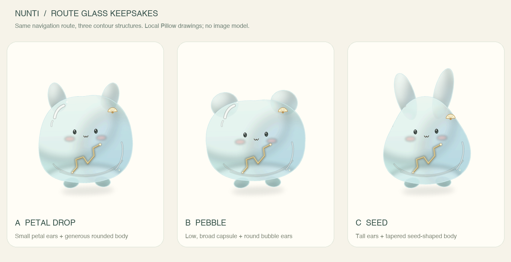
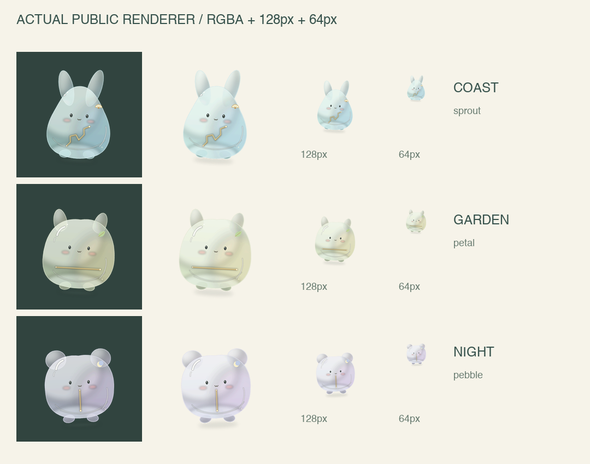

# 목적지·경로 기반 로컬 유리 눈티 렌더러

`render_avatar(points, destination, traits, purpose, journey_id) -> (png_bytes, design_dict)`는
768×768 RGBA PNG를 새로 그린다. Pillow와 Python 표준 라이브러리만 사용한다.
외부 API, 이미지 모델, 고정 캐릭터 PNG, 얼굴 스티커, 다운로드는 사용하지 않는다.

## 조형 선택



- A 꽃잎 귀의 물방울: 작은 귀와 넉넉한 둥근 몸체. 시리즈의 중심 조형으로 추천한다.
- B 둥근 귀의 조약돌: 낮고 넓은 몸체와 방울 귀. 묵직한 소장품 변이로 사용한다.
- C 긴 귀의 씨앗: 위쪽으로 좁아지는 몸체와 긴 귀. 귀가 분명한 변이로 사용한다.

세 안 모두 동일한 경로를 넣어 구조를 비교했다. 제작자는 A를 중심으로 같은 유리 재질·얼굴·금빛 실의 디자인 언어를 선택했고, B/C도 여정별 조형 변이에 포함했다. 귀여움과 소장 욕구에 대한 사용자 평가를 통과했다는 뜻은 아니다.

## 매번 바뀌는 원리

정규화한 실제 경로점, 목적지 이름, 명시된 특성, 여행 목적, 새 여정 ID 전체를 SHA-256으로 묶어 독립 난수 시드를 만든다. 이 시드가 조형, 몸체 비율, 기울기, 일부 귀 길이, 눈 간격·크기, 재질 색과 장식을 정한다. 완성 이미지를 목록에서 선택하지 않으며 같은 시드의 모든 도형·빛·얼굴을 다시 그린다. 동일 입력·동일 여정의 재시도는 같은 바이트를 내고, 새 여정 ID는 새 외형을 구성한다.

경로 전체를 종횡비와 점 순서 그대로 몸체 안의 금빛 실로 옮긴다. GPS·거리·고도·지형·운전 점수·사용자 감정은 추론하지 않는다. 목적지의 지형을 이름만으로 알아냈다고 설명하지 않는다.

특성에 직접 쓴 바다·숲·전시/공예·밤 관련 단어는 각각 조개·새잎·진주·달 장식과 색으로 반영한다. 명시적 특성이 여행 목적보다 우선하며, 특성에 해당 단어가 없을 때 목적의 단어를 확인한다. 둘 다 해당하지 않으면 여정의 색과 중립적인 진주 장식을 구성한다. 이 규칙과 세 조형은 **유한한 조형 문법**이다. 임의의 소재를 이해해 새로운 종을 그리는 이미지 모델과는 구분한다.

## 탄생 모션 연결

`design.routeThread`는 완성 PNG 안의 실제 금빛 실 좌표다.

```json
{"points": [[0.32, 0.71], [0.68, 0.59]], "coordinateSpace": "ASSET_NORMALIZED"}
```

좌표는 그림과 같은 `_route_thread` 헬퍼에서 구하며, 완성 PNG의 미세 회전까지 적용한다. UI는 확인된 원본 경로의 각 점을 이 대응점으로 옮긴 뒤 같은 선을 두꺼운 붓으로 사용해 이미지를 드러낼 수 있다. 별도의 나선이나 가짜 경로가 필요 없다.

## 투명도와 작은 크기 확인



금빛 실을 그린 뒤 유리 뒷면의 빛, 얼굴, 표면 하이라이트를 겹친다. 몸체와 귀, 작은 발은 독립적인 반투명 레이어이며 실제 alpha가 있다. 최종 결과를 2배 해상도에서 LANCZOS로 줄여 가장자리를 부드럽게 한다.

위 비교의 64px에서는 눈·귀·실루엣은 남지만 경로의 미세한 굴곡과 작은 장식은 알아보기 어렵다. 소장품의 상세 감상은 더 큰 이미지에서 해야 한다. `sample-*.png`와 비교 이미지는 검토용 산출물이며 런타임 고정 자산으로 사용하지 않는다.

## 재현과 검사

저장소 루트에서 설치된 backend Python으로 실행한다.

```sh
.worktrees/server/backend/.venv/bin/python docs/design/avatar-generator/illustration/render_comparison.py
PYTHONPATH=backend .worktrees/server/backend/.venv/bin/python -m pytest backend/tests/test_avatar_illustration.py -q
.worktrees/server/backend/.venv/bin/python -m ruff check backend/nunti/avatar_studio/illustration.py backend/tests/test_avatar_illustration.py
```

비교 스크립트는 구조 비교와 실제 공개 함수의 3개 예시, 원본 PNG, 입력·디자인 JSON, 밝고 어두운 배경 및 128/64px 보드를 다시 만든다. 시험 결과는 [VALIDATION.md](VALIDATION.md)에 기록한다.

`design.voice`는 기기 음성 시험용 description/rate/pitch 설계다. 새 음색 모델이나 음원을 생성하지 않는다. 같은 캐릭터의 상용 음색 재현성과 실제 음성의 자연스러움은 이 렌더러의 검증 범위에 포함하지 않는다.
