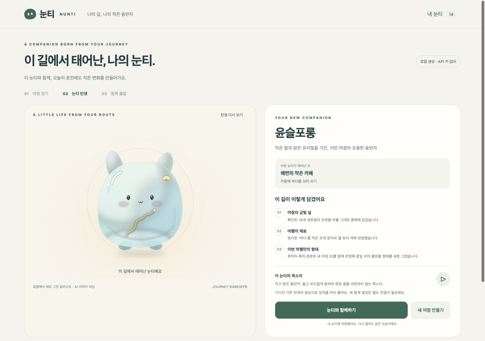

# 눈티 아바타 생성기 v3 통합 검증

2026-11-03. 사용자 담당인 목적지·경로 기반 생성 기능을 구현하고 실제 브라우저와 Pleos Android에서 시험했다. 전체 제품 목표는 운전습관 개선을 돕는 아바타 눈티다. 개선 효과·주행 점수·최종 코멘트를 이번 생성 시험으로 판단하지 않는다.

## 직접 확인한 결과

| 검사 | 결과와 증거 |
|---|---|
| 전체 backend 회귀 | **204 passed, 11 subtests passed**. [JUnit](backend-tests.xml). backend 디렉터리에서 기존 Python 3.12 환경으로 실행했다. 초기 저장소 루트 실행에서는 subprocess가 다른 worktree의 editable 설치를 읽어 2개가 실패했으며, 정상 실행 위치로 바꾼 뒤 모두 통과했다. |
| 실제 Chrome | 입력·생성·같은 요청 재사용·새 여정의 새 이미지·사진 추출·확인·보관·재열기 등 13개 통과. [결과](verification/browser.json). |
| 실제 Android WebView | 동일 흐름과 Canvas 실제 픽셀 존재까지 14개 통과. [결과](verification/android.json). 실제 앱의 main 진입에서 실행했다. 사진 파일은 에뮬레이터 안의 시험 PNG를 사용했다. |
| 비동기 경계 | 실제 HTTP 응답 지연·이미지 로드 지연·목록 GET 실패·표시 gate 복귀 10개 통과. [검토](input-review.md), [결과](verification/input-edges.json). |
| Android 빌드 | Debug·release 모두 통과. 두 APK의 DEX에 새 main 생성 호스트가 포함됐는지 읽어 확인했다. [APK 해시](verification/delivery.json). release는 서명 전이다. |
| Android lint | 오류 0, 경고 12. JS 사용·번역·기존 설정 권고 경고이며 실제 기능 검증을 대신하지 않는다. |
| 실제 차량 상태 경계 | 공식 Pleos Virtual Console UI에서 P→D→P를 조작했다. 앱 로그가 ACTUAL_CAR_SERVICE의 allowed true→false→true로 바뀌었고 시스템의 주행 차단 화면·주차 복귀 화면을 직접 확인했다. [D 차단](verification/android-drive-blocked.png), [P 복원](verification/android-parked.png). 직접 VHAL 쓰기·보호 우회는 사용하지 않았다. |
| 경로와 일러스트 | [추출기 회귀](../../../prototypes/avatar_generator/examples/README.ko.md) 41개, [렌더러 회귀](illustration/VALIDATION.md) 9개와 11 subtests. 둘은 위 전체 backend 검사에 포함된다. 실제 PNG의 금빛 실과 회전 후 routeThread 좌표도 비교했다. |

최종 Debug APK SHA-256은 [delivery.json](verification/delivery.json)에 보관했다. `.local/avatar-generator/Nunti-Avatar-Generator-debug.apk`와 서명 전 release APK가 준비돼 있다. [실행 안내](TESTING.ko.md)의 한 명령으로 현재 PC에서 다시 열 수 있다.



같은 여정 요청의 identity·이미지 SHA·음성 설정은 재시도와 재열기에서 유지됐다. 같은 목적지·경로로 새 여정을 만들 때는 다른 이미지 SHA를 받았다. 이전 목록 조회 실패가 새 요청을 유발하던 문제는 결과와 목록 갱신을 나눠 수정했고 실제 503 주입으로 재검증했다. 원본 사진이 준비되기 전에는 확인을 열지 않으며, 늦은 추출 응답은 최신 선택을 덮지 않는다.

Android WebView의 CDP 정지 화면은 일부 Canvas 합성이 누락되는 현상이 있었다. Canvas의 실제 RGBA 픽셀을 읽어 확인하고 실제 ADB 화면으로 다시 확인했다. 최종 Android 정지 화면은 ADB 원본이다. 영상과 스피커 음성은 녹화하지 않았다.

## 구현·검증의 경계

**완료:** 목적지·경로 사진·좌표 입력, 사용자 확인, 새 로컬 RGBA와 디자인 설명, 실제 금빛 경로실에 이어지는 탄생 연출, 즉시 보관·멱등 요청·복원, 기기 음성 설정 저장과 명시 재생, 공통 main Android 호스트, 선택 이미지 API 어댑터, 실행·회귀 도구와 사용자 안내.

**미구현:** 실제 NaviHelper 입력·Gleo 연동, v3의 캐릭터별 새 음색 생성, 감정·주행 피드백 모듈과 실제 이벤트 payload 통합, 원격 서비스 배포·release 서명·공모전 제출 패키지. 기존 v2의 설계 음색·소장품은 보존했다.

**미검증:** 실제 공급자 계정·새 AI 이미지 품질·비용·지연, Anna에 가까운 새 음색·한국어 자연스러움, 임의의 실제 내비 사진에 대한 추출률, 실차 동작, 사람의 귀여움·소장 의향·운전습관 개선 효과.

기본 로컬 이미지는 세 가지 조형과 명시 키워드 재료를 사용하는 프로젝트 코드의 새 렌더다. 임의 서술을 이해하는 AI 모델 생성이나 무한한 디자인 문법으로 설명하지 않는다. 시험 경로 세 개는 입력 예시이며 캐릭터 선택지·생성 상한이 아니다.

음성은 기기의 기존 한국어 화자를 저장된 속도·높이로 재생하는 미리 듣기다. 이번 검증은 새 음색·청감·자연스러움 승인 결과가 아니다. 한국어 엔진이 없으면 안내하고 이미지 결과는 유지한다.

실제 외부 생성 API 호출은 0회다. 이미지 API 어댑터는 형식·투명도·예산·응답 불명확·중복 방지에 대해 테스트 대역으로 확인했다. 유료 요청을 실행하거나 실패한 요청을 자동으로 재시도하지 않았다. release 빌드는 PC 서버에 의존하는 미서명 시험 호스트이며 제출 준비 완료를 뜻하지 않는다.

## 검사를 다시 실행하기

```sh
cd /Users/pig30nidae/NUNTI/backend
../.worktrees/server/backend/.venv/bin/python -m pytest -q
```

로컬 서버와 Chrome 디버그 포트 9223을 준비하면 `node scripts/verify_avatar_generator.mjs`로 실제 브라우저 흐름을 다시 검사한다. Android 앱이 실행 중이면 `node scripts/verify_avatar_generator.mjs --native --port=9224`가 실제 WebView와 기기 내부 시험 파일을 연결해 검사한다. `node scripts/verify_avatar_input_edges.mjs`는 별도 Chrome을 시작해 경계 회귀를 실행한다. 각 도구는 정지 화면 또는 JSON만 만들며 영상·스피커 녹음은 없다.
