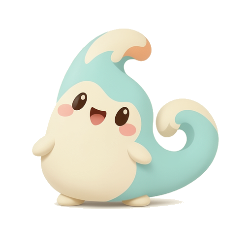
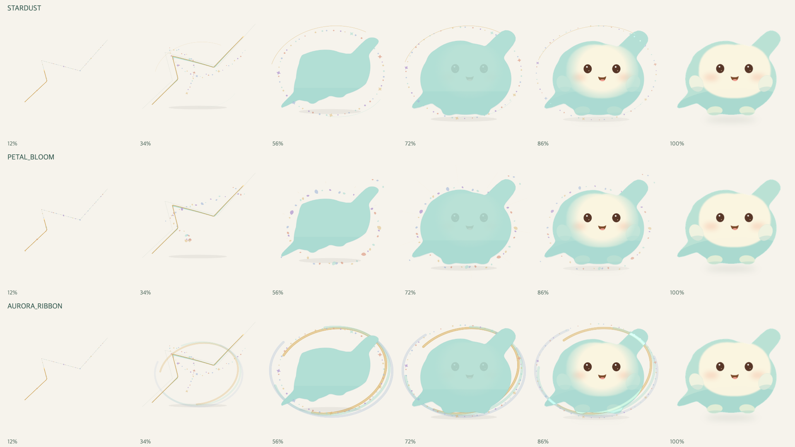

# 눈티 v5 · 깨끗한 일러스트와 풍성한 탄생 효과

2026-11-04 검증 완료: 사진 업로드가 유실되던 비동기 순서 문제를 [재현·수정](PHOTO-UPLOAD-FIX.md)했다. 전체 7단계 실행이 종료 코드 0으로 완료됐고 경계15·Chrome15·Android15·저장AI14·실제Canvas7개35자세를 통과했다. 초기 승인 검토 장애와 미실행 설명은 아래 이력으로 남긴다.

2026-11-03. 전체 제품은 운전습관 개선을 돕는 눈티이며 이번 담당 범위는 목적지·내비게이션 경로 기반 생성이다. 사용자는 생성 효과를 더 화려하게 하고, 몸의 경로가 흉터·얼룩처럼 보이지 않게 하며 일러스트를 발전시키길 요청했다. 불투명 파스텔·얕은 매트 2.5D 기준은 유지한다.

## 실제 새 생성 결과



공개 MLX Community FLUX.2-Klein-4B 4bit를 현재 Mac에서 실행했다. 최종 구조·스타일 참조로 새 해변 눈티를 생성하는 데 44.56초, MLX 보고 피크 3.48GB가 걸렸다. 원본 RGB와 후처리 RGBA를 직접 확인했다. 이번 결과에서는 내부 경로선·줄무늬가 사라지고, 민트·크림의 큰 색면과 두 눈·웃는 입·바깥 꼬리가 나왔다. 사용자의 최종 미적 승인을 받았다는 뜻은 아니다.

## 경로의 역할 변경

세 가지 원인이 있었다. 빠른 렌더는 배에 금빛 경로와 두꺼운 spine 띠를 합성했고, AI 구조 참조에도 내부 선이 들어갔다. 탄생 모션도 성장 중인 몸 위에 centerline을 다시 그렸다.

이제 경로는 큰 굴곡·방향을 통해 실루엣·꼬리·볏을 결정한다. 완성 몸에는 경로를 칠하지 않는다. 모델의 구조 참조에서도 축선·문자·표식을 제거했고 입력을 구조와 스타일 두 장으로 정리했다. 원본 경로는 미니맵·원본 좌표·근거 메타데이터로 보존한다. 새 여정은 새 그림을 생성하며, 같은 요청 재시도와 보관 복원은 원본 정체성을 유지한다.

빠른 렌더의 겹친 반투명 색면·불규칙 조각을 정리하고 얼굴·볼의 검은 번짐도 고쳤다. 이때 경로에서 만든 외곽 기하는 유지된다. `surfaceRouteMarking=NONE`, `routeThread.renderedOnSurface=false`를 명시한다. 이는 생성 의도이며 AI의 모든 픽셀을 자동 검사했다는 뜻은 아니다.

## 새 원화와 효과

내장 image_gen 도구로 기존 A2의 표면 정리와 새로운 표현의 B를 비교했고, B의 여백·주변 halo를 다듬어 [선택 스타일](assets/style-clean-master.png)을 만들었다. 표현이 더 큰 미소와 자연스러운 팔다리, 정돈된 민트·크림 경계가 특징이다. 새 스타일은 구현을 위해 선택한 원화이며 사용자 승인으로 표시하지 않는다. 앱의 매 여정 결과를 이 고정 PNG로 대체하지 않는다.

[A 수정 프롬프트](prompt-clean-a.json), [B 생성 프롬프트](prompt-clean-b.json), [B 정리 프롬프트](prompt-clean-master.json), [자산 SHA](asset-inventory.json)를 보존했다. 내장 도구의 모델 버전은 노출되지 않아 특정 API 모델의 출력으로 표시하지 않는다. Superdesign 로그인은 이전 사용자 지시에 따라 보류했고 사용하지 않았다.

효과는 별가루·꽃잎·오로라 세 안을 같은 기하에서 비교했다. 기본은 오로라 고리와 별가루다. 경로를 따라 빛이 모이고, 몸의 외곽이 실제로 부푼 뒤 바깥의 고리와 별이 안착을 축하한다. 경로선은 진행률 46%, 장식은 98%에 사라진다. 완성 p=1은 원본 PNG이며 별·선·고리를 굽혀 넣지 않는다. reduced motion·차량 gate·기존 소장품은 유지한다.



## 직접 시험

현재 로컬 서버와 Pleos 앱에는 v5가 연결돼 있다. 앱에서 **내 눈티**를 열면 가장 최근의 새 해변 결과를 볼 수 있다. **탄생 다시 보기**로 효과를 시험한다. 기존 소장품은 당시 그림을 보존하므로 흉터 제거 여부는 새 생성 결과에서 확인한다.

```sh
cd /Users/pig30nidae/NUNTI
python3 scripts/run_avatar_generator.py --local-ai --restart-server
```

주차 상태에서 **새 여정 만들기 → 생성 방식 → 로컬 AI · 약 1분**을 선택한다. 경로와 목적지를 확인한 뒤 생성한다. 빠른 코드 렌더도 깨끗한 표면과 새 효과를 사용한다. API 키·유료 외부 호출은 필요 없다.

## 검증과 남은 범위

- 전체 backend 246개와 하위 검사 10개 통과.
- 실제 빠른 RGBA 6개 비교, 순수 기하 7형상·10,010프레임, 효과 603표본 통과.
- 실제 Chrome Canvas는 빠른 PNG 6개와 AI PNG 1개, 총 7개·35자세 통과. 최종 불투명 픽셀 차이 0, 가장자리 최대 차이 1/255다.
- 실제 AI 해변 1건은 HTTP 생성·원본/SHA·alpha 외곽과 실제 Canvas를 확인했다. 2026-11-04 화면 회귀에서 Chrome15·Android15·저장AI14개 검사와 보관 복원을 통과했다. 새 AI 추론 없이 기존 요청을 재사용했다.
- 정원 AI 1건은 당시 자동 승인 검토 용량 오류로 실행되지 않았고 이번에도 추가 생성하지 않았다. Chrome·Android의 초기 검토 서비스 장애는 해소돼 최신 화면 회귀를 완료했다. 과거 거절 사유와 복구 결과를 기록에 함께 보존했다.

[실제 취합 결과](verification/delivery.json), [승인 검토 차단 기록](verification/ui-execution-block.json), [모델 결과와 정원 미실행](verification/model.json), [재현·취합 도구](../../../scripts/verify_avatar_quality_v5.py)를 따른다. 이전 v4의 화면 검사 통과를 v5의 새 통과로 합산하지 않는다. 실제 검증은 영상·스피커 녹음 없이 수행했다.

임의 경로의 정확한 AI 보존, 모든 생성의 얼굴·소장 품질, 최종 사용자 미적 승인은 남았다. 새 음색 생성·실제 NaviHelper·주행 평가 연결·운전습관 개선 효과는 이번에 구현·검증하지 않았다. 유료 API는 계속 보류 중이고 실제 호출은 0회다.

## 이전 승인 검토 장애와 복구

사용자가 로컬 화면 검증 실행을 명시적으로 승인했다. 이후 Chrome 검증 명령을 두 번 시도했으나 자동 검토 모델의 용량 오류로 프로세스가 생성되지 않았다. 당시에는 화면 검사를 통과로 변경하지 않았다. 이후 사진 업로드 결함을 수정하고 2026-11-04 실제 실행을 완료했다.

직접 실행용 [도구](../../../scripts/verify_avatar_ui_v5.py)를 준비했다. 준비한 Python·Chrome·Pleos 환경에서 다음 명령을 로컬 터미널에서 실행할 수 있다. 2026-11-04 승인된 로컬 실행에서 같은 도구의 7단계를 완료했다. `--run`을 생략하면 실제 작업 없이 계획된 명령만 출력한다.

```sh
cd /Users/pig30nidae/NUNTI
python3 scripts/verify_avatar_ui_v5.py --run
```

서버·앱 준비, Chrome 빠른 모드, Android 빠른 모드, 저장된 AI 요청의 모션·복원, 7개 그림의 실제 Canvas, 결과 취합을 차례로 수행한다. 새 AI 추론·유료 API·영상·음성 녹음은 하지 않는다. 도구의 Ruff와 실제 7단계 실행을 확인했으며 최종 취합 결과는 PASS_CLEAN_AVATAR_FUNCTIONAL_DELIVERY다.

사용자는 로컬 터미널 직접 실행 중 사진 업로드 오류를 보고했다. 수정 전 실패와 수정 후 실제 통과 기록을 모두 [버그 수정 보고](PHOTO-UPLOAD-FIX.md)에 보존했다.
