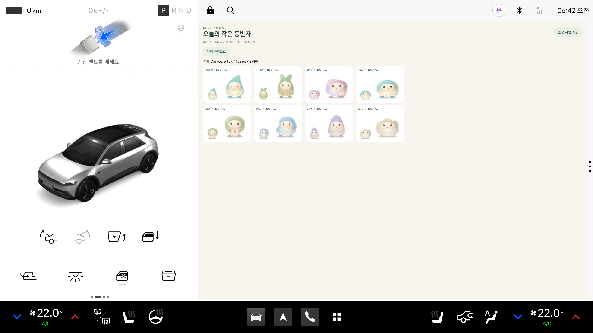

# API 없는 여정 MVP 실제 시험 결과

2026-11-02. 기존 C 반투명 기념 오브젝트 방향을 Android renderer와 로컬 TTS에 연결했다. 의미 태그가 다른 8개 시험 여정에서 생성한 캐릭터를 앱에서 선택하고, 같은 캐릭터의 인사·도착 대사를 듣고 보관한다. 새 여정은 PC worker로 추가할 수 있다. 외부 API·계정·새 모델 다운로드를 사용하지 않았다.

[직접 시험 가이드](../../../prototypes/journey_mvp/TESTING.ko.md)와 [전달한 Debug APK](../../../.local/journey-mvp/Nunti-Journey-MVP-debug.apk)를 제공한다. 실행 파일 자체를 실행해 MainActivity→새 MVP 화면 진입을 확인했다. 에뮬레이터에는 사용자용 초기 화면을 열어 두었다. 사용자 보관함은 비어 있고 음성 시험 확인은 꺼져 있다.

## 구현한 연결

PC worker는 여정 입력을 최초 캐릭터 레시피·표시 이름·음성 지시·실제 WAV·불변 번들로 만든다. Android는 그 번들의 몸체·비례·색·목적지 모티브·경로 무늬·목적·seed를 새 Compose Canvas에서 직접 그린다. 그림자·외피·내부 빛·모티브·불투명 얼굴의 깊이를 나눈 정적 2.5D 표현이다. PNG를 갈아 끼우는 기존 MOCK 화면과 분리했다.

음성은 정확히 같은 characterId의 profile·binding·direction·원문·WAV를 기존 단일 큐에서 재생한다. LocalFileTtsProvider만 주입하며 다른 공급자로 자동 전환하지 않는다. Anna는 사용자 선호 기준이다. 계정 없는 이번 실행은 Sohee 한 화자 안의 연기 변화이며, 무한히 고유한 화자를 생성하지 않는다.

새 여행은 새 캐릭터를 만들고 retry·reroute는 최초 확정을 보존한다. 앱은 선택·도착·보관 상태와 시각·음성·원본 해시를 AtomicFile로 저장한다. 음성 요청과 조용한 시험 승인은 복원하지 않는다. 자동 검사는 `journey-mvp-validation`, 사용자 앱은 `journey-mvp` 공간을 사용한다.

## 실제 확인한 결과

| 항목 | 결과와 증거 |
| --- | --- |
| 여정·생성 | 8캐릭터·8몸체·24WAV. 기존 4캐릭터의 12WAV는 바이트 그대로 재사용했고 추가 4캐릭터의 12WAV만 실제 합성했다. [생성·재시작](../../../prototypes/journey_mvp/restart-verification.json) |
| 캐시·중단 | 독립 프로세스에서 24개 캐시 적중·모델 로드 없음. reroute 3개 캐시 유지. 실제 자식 프로세스 30개로 게시 도중 종료·재시도·변조 거절을 검사했다. [중단 복구](../../../prototypes/journey_mvp/crash-recovery-verification.json) |
| 사용자 입력 | PC 검사 15개. 앱과 같은 UTF-16 길이·최대32캐릭터 경계를 합성 전에 검사한다. 실제 CLI 거절 7건과 기존 원본 보존을 확인했다. [입력 경계](../../../prototypes/journey_mvp/input-boundary-verification.json) |
| 외형 구조 | 8몸체·16개 폐곡선과 비례 경계 400배치, 얼굴 영역 내포를 CPU 검사했다. [실제 결과](../../../prototypes/journey_mvp/geometry-tests.log) |
| 앱 전체 음원 | 실제 Android에서 원본24개 전부 QUEUED→STARTED→COMPLETED. 8개 인사·공통·도착·반복 거절·reroute·보관과 보관8개 복원을 확인했다. [원본 전체 실행](../../../prototypes/journey_mvp/runtime-04/verification.json) |
| 파서·저장 경계 | 실제 Android JSONObject·AtomicFile로 visual 변조, 다른 캐릭터 clip, binding 변경, source 변경 후 복원, 중단 쓰기, 손상 저장 거절을 포함한 10개 검사 통과. 전체 실행의 raw 이벤트에 보존했다. |
| 중지 | 중복 요청이 거절된 뒤 원래 재생 취소, 재생·대기 요청 동시 취소를 최종 APK에서 확인했다. [회귀 검사](../../../prototypes/journey_mvp/stop-runtime-01/verification.json) |
| 누락·손상 | 검증용 음원 한 개의 누락·1byte 변조는 재생 거절, 손상 상태의 cold start는 준비 실패. 선택·binding을 보존하고 원본을 정확히 복원했다. [실제 검사](../../../prototypes/journey_mvp/assets-runtime-02/verification.json) |
| 차량·생명주기 | 공식 Console의 실제 D·속도0에서 숨김·취소·새 요청 거절, P 복귀 후 무발화 통과. Settings로 실제 foreground=false를 확인한 background 취소·복귀 무발화도 통과. [D/P](../../../prototypes/journey_mvp/drive-runtime-02/verification.json), [최종 앱 생명주기](../../../prototypes/journey_mvp/lifecycle-runtime-01/verification.json) |
| 실제 출력 | 새 숲 캐릭터의 스피커 PCM을 인증된 에뮬레이터 스트림에서 수집했다. 같은 문장인 다른7캐릭터를 대조해 시간별 대역 에너지 NCC는 예상 원본0.9473, 대조군0.2904~0.5498이었다. 음질·화자 고유성 판정은 아니다. [측정](../../../prototypes/journey_mvp/audio-runtime-01/verification.json) |
| 원문 대조 | 기존 표본과 별개로 새12개를 원문 prompt 없이 한 번씩 전사했다. 11개 정규화 일치, `숲을`→`수플` 1건은 연음의 표기 차이일 수도 있다. 기존 산 도착의 `산빛을`→`삼비칠`도 청취 확인 대상으로 유지한다. [새 전사](../../../prototypes/journey_mvp/asr/summary.md) |
| 빌드·설치 | Debug·Release 빌드, Debug lint 통과. TTS 기존62·로컬33·통합8·실제WAV24 검사 통과. Debug 새 번들28파일은 원본과 바이트 동일하고 Release에는0개다. 두 앱 공간의 WAV48개 해시도 원본과 일치했다. [전달 확인](../../../prototypes/journey_mvp/delivery-observation.json) |

공통 문장은 기존 큐의 전역60초 반복 제한을 지켰다. 새 캐릭터로 바꾸거나 새 세션을 만들어 제한을 우회하지 않고, 실제 STARTED 관찰 후 대기했다.

## 외형 검토 범위

최종 APK에서 8체형의 중립 표정, 구름 체형의6표정, 밝은·어두운 배경과 실제64/128px Canvas를 캡처했다. PM과 AVATAR가 화면을 직접 확인했고 잘림·얼굴 가림·눈과 입의 경로띠 침범은 관찰하지 않았다. 64px의 편안함과 안도는 차이가 작다. 8몸체×6표정의 모든 조합이나 사람의 감정 식별률을 검사한 결과는 아니다.



## 실행 기록의 범위

`runtime-04`는 24개 음원·8개 보관 복원까지 통과한 뒤, Pleos에서 HOME 키가 앱을 실제로 가리지 않아 background 검사가 실패했다. 원래 FAIL 상태와 raw 기록을 보존했다. 실제 Settings 전환으로 foreground=false를 확인하는 별도 검사를 최종 APK에서 통과했다. 마지막 제출 ID만 중지하던 문제도 전체 큐 중지로 고치고 재생·대기 회귀 사례를 최종 APK에서 확인했다.

전체 음원 실행에 쓴 APK와 최종 APK의 해시는 [통합 검증](../../../prototypes/journey_mvp/delivery-verification.json)에 각각 기록한다. 최종 APK는 별도로 8개 외형 선택·생명주기·D/P·손상·중지·출력·사용자 실행 파일을 시험했다. 첫 JSON 정규화 실패, 다른 오디오 차단, 정상 반복 제한 거절, 짧은 주행 제어 타이밍 실패, legacy ADB 전송의 부분 블록 손실 기록도 삭제하지 않았다. 검증용 파일은 shell-v2 전송으로 원본203,564byte를 복구하고 해시까지 확인했다.

보존된 실제 바이트와 원본 이벤트를 다시 읽는 검사는 다음과 같다. 현재 기기나 사람 청취를 새로 시험하는 명령은 아니다.

```sh
.local/journey-voice-v3/venv/bin/python prototypes/journey_mvp/verify_delivery.py
```

## 남은 범위

완료한 것은 API 없는 PC 생성→앱의 정적 외형 생성→같은 캐릭터의 음성 재생→도착·로컬 보관·복원 시험이다. 새 여정은 PC worker와 APK 갱신을 거친다. 제품의 실제 내비 여정 시작·서버 작업·컬렉션 동기화·동의와 삭제 정책은 아직 연결하지 않았다.

Android 안의 모델 추론, Anna API 재현, 애니메이션 rig, 실차와 일반 물리 Android 기기의 검증은 남았다. 자연스러움·귀여움·소장 의향·장기 청취·운전습관 개선·정확한 취소 후 무음 지연도 이번 자동 검사로 승인하지 않는다.
