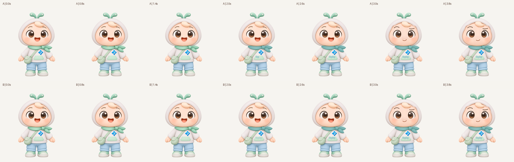

# 눈티 변신 모션 v1

승인된 A 눈티의 공통 레이어로 만든 **Figma Motion 원본과 실행 가능한 Android Canvas 비교용 프로토타입**이다. 캐릭터의 위치·크기·몸체는 고정하고, 경로 무늬 → 스카프 색 → 목적지 장식 → 직접 고른 표정 순서로 4초 동안 바꾼다.

## 실제 모션과 파일

사용자가 선택한 TOZI 팀에 새 [Figma 파일](https://www.figma.com/design/LHLHBra8ON3OdVW0qhBnbm)을 만들었다. Figma MCP의 Motion API로 키프레임을 직접 작성하고, `get_design_context`와 `get_motion_context`로 다시 읽어 구현에 사용했다.

| 방향 | 실제 Figma 타임라인 | 미리보기 | 차이 |
| --- | --- | --- | --- |
| A · 빛의 길 | [프레임 4:13](https://www.figma.com/design/LHLHBra8ON3OdVW0qhBnbm?node-id=4-13) | [24fps MP4](figma-a-light-trail-24fps.mp4) | 스카프 선과 포켓 장식이 왼쪽부터 드러난다. 작은 따뜻한 빛이 스카프 선을 따라간다. |
| B · 고요한 색 | [프레임 4:56](https://www.figma.com/design/LHLHBra8ON3OdVW0qhBnbm?node-id=4-56) | [24fps MP4](figma-b-quiet-color-24fps.mp4) | 같은 시간 순서에서 무늬의 불투명도만 부드럽게 높인다. 빛 효과는 없다. |

**A를 추천한다.** 작은 스카프 선이 생기는 순간을 읽기 쉽고, 국소적인 빛이 경로와 외형 변화의 관계를 설명한다. B는 더 차분한 대안이다. B도 애니메이션이며, 접근성의 ‘움직임 줄이기’와는 별개다. 움직임 줄이기는 두 방향 모두 재생을 생략한다.



영상은 768 × 768, 24fps다. 타임라인은 4000ms이고, Figma 내보내기 파일은 끝점 프레임을 포함해 약 4.042초다. Figma 편집기 미리보기의 반복 설정은 Android에 이식하지 않았다. Android는 명시적 재생 한 번에 한 번만 실행한다.

## 시간과 표현

| 시간 | 동일한 눈티에 적용하는 변화 |
| --- | --- |
| 0–450ms | 원래 표정과 몸체를 그대로 보여준다. |
| 450–1300ms | 경로에 맞는 스카프 무늬를 드러낸다. A의 빛은 이 무늬의 작은 영역에만 놓인다. |
| 1300–1900ms | 목적지의 스카프 색 포인트를 더한다. |
| 1700–2500ms | 포켓의 물결·능선·창문 장식을 더한다. |
| 2850–3050ms | 얼굴 안쪽 표정만 바꾼다. 눈·입의 기준 위치와 머리 외곽은 움직이지 않는다. |
| 3050–4000ms | 완성된 모습으로 안정시킨다. 4000ms부터 기존 생성 결과 PNG 자체를 그린다. |

공통 easing은 `cubic-bezier(0.4, 0, 0.2, 1)`이다. A의 작은 빛은 450–550ms에 켜지고, 1200–1300ms에 꺼진다. 반경은 768px 좌표계에서 잔광 8px·중심 3px이며, 얼굴을 덮지 않는다. 최초 700ms 표정 전환에서 입 모양이 겹쳐 보여 실제 프리뷰를 확인한 뒤 200ms로 줄였다.

기본 6개 레이어는 한 장의 `core.png`로 사전 합성해 매 프레임 고정한다. 스카프·포켓은 기존 목적지 레이어의 빈 줄 사이에서 나눴다. 새로운 몸체나 장식을 생성하지 않았다. 기존 기본 원화와 정적 변형 에셋은 그대로 보존했다.

## 기존 Android 구조와 연결

현재 앱의 네이티브 캐릭터 표시와 같은 Android `View`/`Canvas` 방식으로 구현했다. 새 영상 플레이어나 Lottie 의존성은 추가하지 않았다. 최종 프레임을 기존 PNG와 정확히 일치시키기 위해 래스터 레이어를 직접 그린다.

| 파일 | 역할 |
| --- | --- |
| [TransformationTimeline.kt](../../../android/app/src/debug/kotlin/ai/nunti/app/transformation/TransformationTimeline.kt) | Figma timing/easing, 재생·중단·건너뛰기 상태 |
| [TransformationCanvasView.kt](../../../android/app/src/debug/kotlin/ai/nunti/app/transformation/TransformationCanvasView.kt) | 고정 코어와 선택 레이어, 두 모션 방향, 최종 PNG 표시 |
| [TransformationAssets.kt](../../../android/app/src/debug/kotlin/ai/nunti/app/transformation/TransformationAssets.kt) | APK 로컬 파일의 SHA256·크기·타입 검사 |
| [TransformationPreviewActivity.kt](../../../android/app/src/debug/kotlin/ai/nunti/app/transformation/TransformationPreviewActivity.kt) | 실제 차량 제한, 명시 재생·바로 보기·모션 축소, 주야간·창 크기 대응 |
| [asset manifest](../../../android/app/src/debug/assets/nunti_motion_v1/manifest.json) | 기본형 + 9개 생성 결과, 공통 레이어, 출처·버전·해시 |
| [빌더](../../../scripts/build_nunti_motion_assets.py) | 원본을 보존하며 모션 번들을 재현하고 최종 픽셀 일치를 검사 |

프로토타입은 기존 앱의 **debug 전용 Activity**다. 저장된 바다·산·도시 × 기분 3종의 실제 PNG·AvatarSpec을 사용한다. UI에서 목적지·기분과 A/B 방향을 바꿔 재생할 수 있다. 기존 생성 서버, 컬렉션, Journey 점수·음성, 운영용 기본 화면은 변경하지 않았다. 임의의 새 Studio 결과를 받아 자동으로 변신시키는 운영용 연결은 포함하지 않는다.

## 차량 제한과 접근성

기존 `StudioCarGate`를 사용한다. 실제 차량의 기어 P, 속도 0, 알려진 `CarUxRestrictions`, 제한 없음과 앱 전경 상태를 모두 만족해야 재생할 수 있다. UX 변경 callback과 약 33ms 간격의 프레임 검사에서 조건을 다시 확인한다.

- 제한 또는 백그라운드 진입 시 재생을 취소한다. 준비된 최종 프레임으로 상태를 확정하고, 차량 UI 허가가 없으면 화면 전체를 차단한다.
- 주차 상태가 돌아와도 자동 재생하지 않는다. 사용자가 ‘변신 보기’를 눌러야 새로 시작한다.
- ‘바로 보기’는 즉시 완성된 모습으로 간다. 로딩 중이면 기본 눈티를 보여주고, 자산 준비 후 정지 결과만 보여준다.
- ‘움직임 줄이기’는 저장되는 옵션이다. Android 시스템 애니메이터 비활성 설정도 따른다. 재생 중 켜면 바로 정지 결과로 간다.
- 모션 자산은 APK에 있다. 서버·인터넷·이미지 생성 API가 필요 없다. 누락·손상 자산은 기본 눈티로 돌아간다.
- 디버그 캡처·시점 이동도 실제 차량 허가를 요구한다. Intent로 차량 허용 상태를 넣는 우회 경로는 없다.

새 Activity에 `distractionOptimized`를 추가하지 않았다. 주행 중 앱 사용 허가를 확대하지 않는다. 이 정책은 [Pleos 운전자 주의 분산 가이드](https://document.pleos.ai/en/docs/pleos-only/vehicle-app-planning-guide/driver-distraction-guideline)와 [UI 가이드](https://document.pleos.ai/docs/connect/guide/docs-design/Introduction/intro)의 주행 중 장식 움직임 제한에 따른다.

## 재현과 핸드오프

프로젝트 루트에서 에셋을 재현한다. 기존 원화와 이전 변형 결과가 필요하다.

```sh
.worktrees/server/backend/.venv/bin/python scripts/build_nunti_motion_assets.py
```

설치된 debug APK의 실행 진입점은 `ai.nunti.app.transformation.TransformationPreviewActivity`다. 자동 검증의 실행 명령·결과는 [verification.md](verification.md)에 기록한다.

[Figma 실제 모션 문맥](figma-motion-context.json), [모든 수동 키프레임](figma-manual-tracks.json), [디자인 구조 A](figma-design-context-a.json), [디자인 구조 B](figma-design-context-b.json), [PNG와 Figma 이미지 매핑](figma-assets-and-render.json)을 함께 보관했다. `figma-use-motion`으로 만든 값을 `figma-implement-motion` 절차에 따라 Canvas의 동일 시간·easing·레이어 속성으로 옮겼다.

다음 운영 연결은 두 방향 중 하나를 선택한 뒤 진행한다. 기존 Studio의 최종 PNG·AvatarSpec을 검증해 이 재생기에 전달하고, 현재 정적 fallback을 유지하는 작은 연결부가 적절하다. 캐릭터 원화를 다시 생성하거나 서버를 재작성할 필요는 없다.
