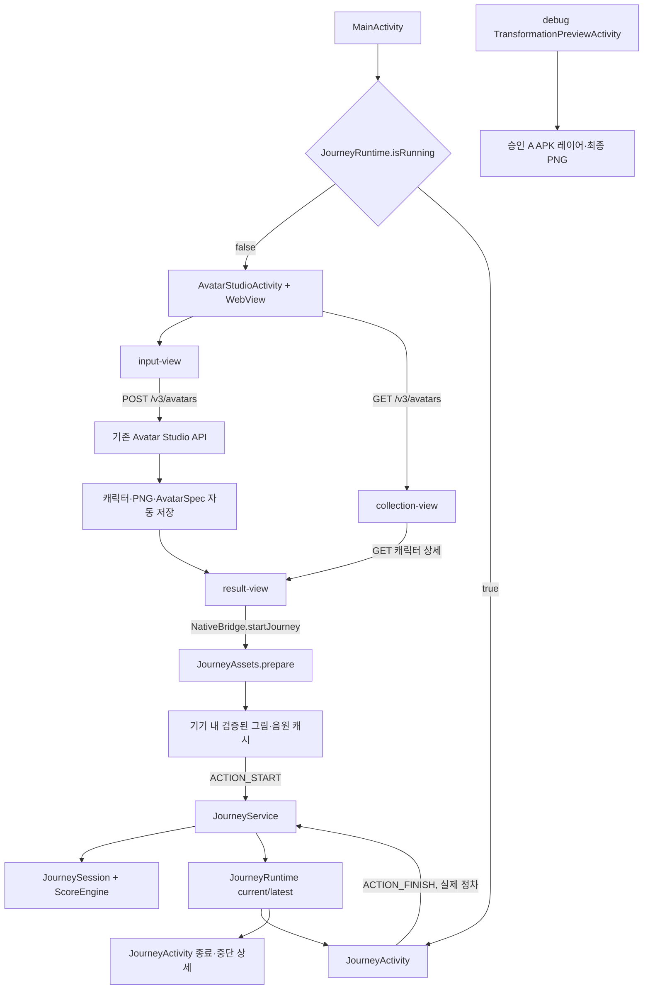

# 눈티 Figma 화면과 Kotlin·데이터 연결

기준: 2026-11-10 현재 소스. 이 문서는 기존 함수와 데이터 계약을 재사용하기 위한 연결표다. 아래 `설계 제안` 이름은 새 Compose 구현이 이미 존재한다는 뜻이 아니다. 이번 작업에서 앱 코드는 변경하지 않았다.

## 1. 현재 실행 흐름

debug 변신에서 Studio 결과 또는 여정 시작으로 이어지는 화살표는 현재 없다. `JourneyAssets.prepare`는 최종 PNG·음원을 캐시하며 native 변신용 공통 레이어나 AvatarSpec을 전달하지 않는다.

## 2. 상태 결정과 차량 권한

| UI 개념 | 실제 결정식 또는 함수 | 연결 시 보존할 점 |
|---|---|---|
| Studio 사용 가능 | `AvatarStudioActivity.refreshGate`: foreground와 `StudioCarGate.canDisplay()` | JS나 Intent의 임의 플래그로 차량 권한을 만들지 않음 |
| 정차 가능 | 실제 `GEAR_SELECTION=P`, 유효 speed의 절댓값 `<0.01`, 알려진 CarUxRestrictions, `!requiresDO`, restrictions 0 | unknown·예외·연결 끊김은 허용하지 않음 |
| 활성 여정 | `snapshot.state == ACTIVE && JourneyRuntime.isRunning` | 저장된 ACTIVE JSON만으로 세션을 재개하지 않음 |
| Journey 정차 UI | `parkedNow() && (!active || snapshot.canFinish)` | `canFinish`는 서비스도 독립적으로 판정. 화면 버튼만의 허가로 종료하지 않음 |
| 출발 전 | Studio `screen('input')` | 기존 `state.route`, destination, purpose, variantContext 입력을 보존 |
| 주차 중 결과 | Studio `screen('result')`, `showArtifact` | `LOCAL_LAYERS`는 정적. native 변신 연결은 별도 변경 |
| 주행 제한 | Journey의 활성 상태이며 정차 UI 조건 불충족 | 상세 scroll, 종료·복귀 동작을 숨김. 현재 본문/음성 제어는 유지 |
| 도착 후 | snapshot `FINISHED`이며 정차 | manual finish 결과. 목적지 도착 추론으로 만들지 않음 |
| 중단 기록 | `INTERRUPTED` 또는 실행 중 서비스 없는 저장 ACTIVE 복원 | 완료 기록과 별도 표기 |

관련 코드: [Studio gate](/Users/pig30nidae/NUNTI/android/app/src/main/kotlin/ai/nunti/app/studio/AvatarStudioActivity.kt:176), [실제 Car 판정](/Users/pig30nidae/NUNTI/android/app/src/main/kotlin/ai/nunti/app/studio/AvatarStudioActivity.kt:318), [Journey refresh](/Users/pig30nidae/NUNTI/android/app/src/main/kotlin/ai/nunti/app/journey/JourneyActivity.kt:141), [복원 정책](/Users/pig30nidae/NUNTI/android/app/src/main/kotlin/ai/nunti/app/journey/JourneyRuntime.kt:23).

`JourneyActivity` manifest의 distraction-optimized 선언은 공식 허가 여부와 구분한다. 새 변형 화면에 그 선언을 복사해 움직임을 허용하는 방법은 사용하지 않는다.

## 3. Figma 영역별 실제 구현 연결

실제 제작한 파일은 `LHLHBra8ON3OdVW0qhBnbm`, 페이지는 `15:4`다. 낮 기준 출발 전 `24:221`, 정차 결과 `24:416`, 주행 정적 제안 `24:530`, 종료 후 `24:600`, ACTIVE/P `30:823`, 여정 옵션 `31:1159`, 생성 방식 `31:1249`로 연결된다. 전체 주야간·좁은 창 링크는 [디자인 인덱스](README.md)에 있다. 실제 주행 중 플랫폼 차단 관측은 [runtime 검증](runtime-verification.md)을 우선한다.

| Figma 영역 이름 제안 | 현재 구현 | 현재 읽는 값·동작 | 기존 코드를 보존하는 연결 방향 |
|---|---|---|---|
| `PreTrip/RouteSummary` | HTML `navigation-tools`, `route-map`; `navigation.js` | native snapshot, OSRM plan, route confirmation | 현재 bridge와 plan validation을 그대로 쓰고 정보 배치 변경 |
| `PreTrip/TripInputs` | HTML `journey-form`; `studio.js` submit | destination, traits, purpose, renderMode, variantContext | label·spacing·component를 바꿔도 request 계약 유지 |
| `PreTrip/MoodChoice` | `layer-options`의 `layer-mood` | 사용자가 직접 선택한 `userSelectedMood` | SDK/점수 emotion과 분리한 선택 component |
| `Reveal/CharacterStage` | `showArtifact`, `drawStaticArtifact`, `birthAnimation` | artifact visual PNG, design, mediaOrigin | A 정적 결과와 legacy formation 분기를 보존. native 모션 연결은 adapter가 필요한 후속 작업 |
| `Reveal/PrimaryActions` | `journey-button`, `new-button`, `prepare-journey-voice` | native start, 입력뷰 복귀, 명시적 음성 생성 | 저장 완료 여부를 새 API로 다시 만들지 않음 |
| `Collection/CharacterCard` | `showCollection`의 button/img/name/destination | `GET /v3/avatars`, 상세 GET | 캐릭터 ID를 보존한 목록·상세 동작 |
| `Driving/Companion` | `JourneyCompanionView.setIllustration` + `onDraw` | cached bitmap, displayName, score emotion | 승인 A 외형 유지. 캐릭터 선택 기분을 주행 emotion으로 덮어쓰지 않음 |
| `Driving/Feedback` | `JourneyActivity.refresh` | total, coverage, line, elapsedMs, voiceStatus | 기존 계산값을 표시만 변경. 신호 부족 상태 유지 |
| `Driving/AllowedActions` | native Button row | mute, openNavigation, 조건부 finish/back | 실제 gate와 서비스 재검증 보존 |
| `PostTrip/Summary` | `JourneyActivity.updateDetails` | items[].label/score/basis, events[].tMs/label | 기존 local report로 summary와 상세를 배치 |
| `Shared/Restriction` | Studio `shield`; debug 모션 `shield` | 실제 차량 권한·foreground | 전면 차단을 UI 오류 또는 네트워크 loading과 구분 |
| `Shared/DayNight` | production에 통합된 token source 없음 | 기존 WebView/CSS와 Kotlin literal colors | Figma semantic tokens를 양쪽 스타일에 나중에 매핑. 현재 구현된 테마 전환으로 표기하지 않음 |

production 출발 전 화면을 Kotlin/Compose로 옮기는 결정은 시각 변경보다 큰 이관이다. 지금 재사용 가능한 최소 경계는 WebView의 input/result/collection 함수와 native Journey의 `buildView/refresh/updateDetails`다. 새 Compose를 선택하더라도 현재 bridge, request 계약, 캐시, 세션, 점수 엔진을 다시 작성할 이유는 없다.

## 4. 입력 계약과 출처

실제 요청 타입은 [AvatarInput/Route/Destination](/Users/pig30nidae/NUNTI/backend/nunti/avatar_studio/models.py:153), 승인 A 문맥은 [VariantContext](/Users/pig30nidae/NUNTI/backend/nunti/avatar_studio/variant_spec.py:42)다.

| 입력 | 현재 계약 | UI에서 구분할 의미 |
|---|---|---|
| `requestId` | canonical UUID string | 생성 재시도 식별자. 경로나 여정 기록 ID가 아님 |
| `destination.name` | 필수, 최대 60 | 사용자가 확인할 목적지 이름 |
| `destination.traits` | 선택, 최대 240 | 기존 생성·목소리 설명용 텍스트 |
| `purpose` | 선택, 최대 120 | 방문 이유. 선택 기분과 별도 |
| `route.points` | 2~512개의 `[x,y]`, 각 0~1, 유효 길이 필요 | 화면에 정규화한 경로선. GPS 좌표 자체가 아님 |
| `route.confirmed` | literal true | 경로가 존재하면 사용자 확인 필요 |
| `route.inputOrigin` | `TEST_ROUTE/NAVIGATION_SCREENSHOT/ROUTE_FILE/API_ROUTE` | 합성 예시, 화면 선 추출, 파일, 외부 길 계산의 출처 |
| `route.extractionId` | screenshot일 때만 UUID | 업로드 원본 및 추출 결과 연결 |
| `route.apiPlanId` | API_ROUTE일 때 64자 hex | 서버 저장 plan과 변경되지 않은 출발·목적지·geometry 연결 |
| `renderMode` | 기본 `LOCAL_RENDER`; opt-in `LOCAL_LAYERS/LOCAL_MODEL/IMAGE_API` | 모드마다 외형·시간·비용·모션 동작이 다름 |
| `variantContext.destinationCategory` | coast/mountain/city/unknown 등 typed enum | A의 포켓·스카프 장식 유형. 실제 SDK 지형이라고 가정하지 않음 |
| `variantContext.roadType` | urban/highway/rural/mixed/unknown | A의 작은 경로 무늬 유형 |
| `variantContext.userSelectedMood` | calm/curious/adventurous/unset, mapper는 추가 unsupported 값을 안전 처리 | 명시 선택한 외형 표정. 운전 감정 추론 금지 |
| `variantContext.routeId/seed/mappingVersion` | 안정 경로 ID, 기본 seed `0`, 버전 `nunti-layers-v1` | 반복 가능한 외형 선택과 출처 기록 |
| `variantContext.provenance` | 필드별 source | 사용자 선택·앱 계산·mock·fallback을 유지 |

`LOCAL_LAYERS`는 `route=null` 또는 누락을 허용하고 장식·표정 모두 기본으로 돌린다. 다른 모드는 route 누락을 거부한다. `variantContext`는 다른 모드에 보내지 않는다. A의 알려지지 않은 목적지/도로 또는 미선택 기분은 해당 요소만 중립으로 처리하고 `fallbackReasons`에 남긴다.

### 내비 입력과 경로선

[PleosNavigationAdapter.snapshot](/Users/pig30nidae/NUNTI/android/app/src/main/kotlin/ai/nunti/app/navigation/PleosNavigationAdapter.kt:140)은 `destination`, `currentLocation`, `routeState`, `trip`, `tbt`와 연결 상태를 제공한다. `geometryStatus=NOT_PROVIDED_BY_PUBLIC_SDK`, `tripRoutePointsRole=WAYPOINT_DESTINATION_SUMMARY_NOT_ROAD_POLYLINE`을 명시한다.

`navigation.js.importNative`는 현재 위치·목적지·경로 상태 callback을 확인한 뒤 좌표를 채운다. `calculate`는 그 출발·목적지로 별도 OSRM 요청을 만든다. 현대 내비의 route signature가 바뀌면 기존 경로 확인을 해제한다. Figma의 경로 카드에서도 내비 메타데이터와 외부 계산 geometry가 같은 원천이라고 설명하지 않는다.

### 서로 다른 식별자

| 식별자 | 용도 |
|---|---|
| `requestId` | 한 번의 생성/재시도 |
| artifact `characterId = nunti-{requestId}` | 서버 보관 캐릭터, 음원, native 선택 |
| `avatarSpec.variantId` | 정규화 시각 입력·버전으로 만든 외형 식별자. 다른 캐릭터 기록도 동일 외형을 가질 수 있음 |
| `apiPlanId` | 저장된 외부 경로 계산 결과 |
| `variantContext.routeId` | 레이어 mapper의 안정 경로 입력 |
| native `sessionId` | 캐릭터를 선택해 실제 또는 DEMO 주행을 시작한 기기 내 한 여정 |

## 5. API와 버튼 연결

### 현재 Studio와 native 준비에서 호출하는 v3

| 동작 | 정확한 호출 | 저장·실패 의미 |
|---|---|---|
| 로컬 연결 | `POST /session` | 로컬 Studio 세션 인증. 생성 API 키와 구분 |
| 가용 기능 | `GET /v3/capabilities` | 옵션 노출. A mode는 `motion=none`, `missingRouteBehavior=STATIC_BASE` |
| 입력 예시 | `GET /v3/examples` | 입력 사례 조회 |
| 경로 계산 | `POST /v3/route-plans` | 별도 외부 OSRM 계산과 서버 저장 |
| 저장 경로 재조회 | `GET /v3/route-plans/{planId}` | 기존 plan 재사용 |
| 화면에서 선 추출 | `POST /v3/route-extractions` | 원본·선·warnings 보관. 사용자가 다시 확인해야 함 |
| 캐릭터 생성·저장 | `POST /v3/avatars` | PNG/design 생성 후 store.complete. 동일 requestId·동일 요청은 기존 결과, 충돌 요청은 거부 |
| 내 눈티 | `GET /v3/avatars` | owner별 전체 artifact 목록, 최신 저장순. 최근 voice 상태 결합 |
| 보관 캐릭터 열기 | `GET /v3/avatars/{characterId}` | 저장된 PNG·design·route·voice로 결과 화면 복원 |
| 그림/JSON/음원 | `GET /v3/assets/{sha}` | content hash 자산. native 캐시는 SHA256 검증 |
| 인사 목소리 준비 | `POST /v3/avatars/{characterId}/voice` | 사용자가 요청한 로컬 음성 준비 |
| 주행 대사 준비 | `POST /v3/avatars/{characterId}/feedback-voice/{kind}` | NEUTRAL/WORRY/RELIEF/JOY 음원 준비 |
| 준비된 대사 가져오기 | `GET /v3/avatars/{characterId}/feedback-voice/{kind}` | `JourneyAssets.prepare`는 GET만 사용. 출발 중 모델 생성을 시작하지 않음 |

API 정의는 [avatar_studio/api.py](/Users/pig30nidae/NUNTI/backend/nunti/avatar_studio/api.py:314), 캐릭터 저장과 목록 정렬은 [storage.py](/Users/pig30nidae/NUNTI/backend/nunti/avatar_studio/storage.py:179)에서 확인했다. 캐릭터 삭제·별도 save·이름 변경·주행 기록 목록 endpoint는 이 v3에 없다.

### 네이티브 동작과 기기 저장

| 화면 동작 | 함수와 후속 작업 |
|---|---|
| 새 여정 만들기 | JS `screen('input')`. HTTP 없음, 기존 데이터 삭제 없음 |
| 함께하기 | `NativeBridge.startJourney(characterId,source)` → `JourneyAssets.prepare` → `JourneyService.ACTION_START` → `JourneyActivity` |
| 이미 진행 중인 여정에서 함께하기 | 새 세션을 만들지 않고 `existing=true`, 기존 JourneyActivity를 엶 |
| 진행 중인 여정·마지막 리포트 | `NativeBridge.openJourney()` → `JourneyRuntime.current` 또는 `latest(context)` |
| 여정 종료 | `JourneyActivity`가 실제 정차와 ACTIVE 확인 → `ACTION_FINISH` → 서비스도 `canFinish()` 재확인 → `JourneySession.finish()` |
| mute | `ACTION_MUTE`, boolean `mute`; 서비스가 음원 중지 및 상태 저장 |
| 내비 열기 | explicit resolved `NAVI_START` Intent. 서비스 종료 없음 |
| 돌아가기 | `Activity.finish()`. `ACTION_FINISH`와 다름 |

기기 저장 위치는 `journeys/assets/{sha}.png|wav`, `{sessionId}-input.json`, `{sessionId}-report.json`, `journeys/latest.json`이다. `AtomicFile`을 사용한다. 서비스는 forced 변화·정차 상태 변화 또는 약 5초마다 snapshot을 저장한다. 프로세스가 죽은 ACTIVE 기록은 다시 운전 중이라고 표시하지 않는다.

### 존재하지만 이 화면에 연결되지 않은 v1 서버

[backend/nunti/api.py](/Users/pig30nidae/NUNTI/backend/nunti/api.py:220)에는 별도 `/v1/trips`, `/v1/trips/{tripId}/route`, `/avatar`, `/events`, `/emotions`, `/report`와 trip 삭제 API가 있다. 이들은 `syncEnabled`로 제한하는 기존 동기화 API다. 현재 `android/app/src/main`의 Studio→Journey 경로는 이 endpoint를 호출하지 않는다.

따라서 도착 후 화면에 "서버에 주행 기록 저장됨"이나 "모든 주행 기록 불러오기"를 넣으려면 실제 연결 구현이 추가로 필요하다. 현재 정확한 표현은 기기 내 여정 저장과 서버 캐릭터 자동 저장을 구분하는 것이다.

## 6. Journey 화면 데이터

| 필드 | 만들어지는 곳 | 표시 |
|---|---|---|
| sessionId/characterId/displayName/destination/purpose/source | `JourneyAssets.prepare` metadata | 선택한 눈티와 여정 출처 |
| imageFile/voices/staticOnly | 서버 artifact와 검증된 기기 캐시 | 고정된 그림·기존 음원·A 모드 정적 정책 |
| state | 서비스 publish, 복원 정책 | ACTIVE/FINISHED/INTERRUPTED |
| elapsedMs/sampleCount/speedKmh/gear | `JourneySession`과 실제 signal source | 시간·검증 기록. 차속/기어를 앱에서 플랫폼 영역처럼 중복 설계하지 않음 |
| total/coverage/items/events | 기존 `ScoreEngine.evaluate` | 점수, 평가 가능 비율, 항목별 basis, 시각별 이벤트 |
| emotion/line/feedbackKey | `JourneySession` | 캐릭터의 주행 피드백. 직접 선택한 mood와 다른 enum |
| voiceStatus/muted | `JourneyService` | 음원 준비/재생 상태 및 음성 on/off |
| canFinish | 서비스의 실제 Car gate | 종료 버튼 조건 |

`JourneyCompanionView`는 원본 bitmap에 pose와 주변 cue를 더한다. 현재 A의 `staticOnly=true`는 그 pose animation을 비활성화한다. legacy 캐릭터의 850ms 모션은 `setEmotion`에서 값이 같으면 먼저 반환하므로, 향후 모든 모션의 차량 제한 중단을 이 함수에만 의존하지 않는다. 새 모션의 독립적인 terminal-state/중단 정책은 debug prototype에 구현되어 있으며 production으로 이관할 때 별도 검토가 필요하다.

## 7. 연결 시 검증 항목

| 확인할 상황 | 소스상의 기대 동작 | 새 디자인 검증에서 볼 점 |
|---|---|---|
| A route 누락 | static base, route receipt 없음 | 빈 경로를 오류나 임의의 길로 표시하지 않음 |
| category/mood 미선택 | 해당 요소 fallback | 사용자 선택을 강제로 추론하지 않음 |
| 입력 변경 후 재시도 | pending request ID 갱신 또는 동일 재시도 유지 | 이중 캐릭터 저장·중복 출발 방지 |
| P→D 또는 UX 제한 | Studio 차단, 모션 중단 | 실제 Console/CarUx 데이터로 확인. UI 토글로 권한을 위조하지 않음 |
| D→P 복귀 | 정적 결과, 자동 모션 재개 없음 | 새 화면도 같은 정책 유지 |
| 음성 없는 출발 | 준비된 clip만 사용, 누락은 텍스트 안내 | mandatory voice generation으로 출발을 막지 않음 |
| 서버 단절 | Studio 오류/재시도; 진행 중 Journey 로컬 유지 | 서버가 없는 상태와 차량 신호 부족을 구분 |
| 종료 후 재실행 | latest FINISHED 또는 INTERRUPTED | 완료하지 않은 여정을 완료로 바꾸지 않음 |
| Figma 주야간·다중 창 | production 적용은 후속 작업 | 실제 앱 bounds, 글자 확대, 대비, touch target, scroll 접근성 비교 |

기존 검증 도구는 [verify_nunti_layers_live.mjs](/Users/pig30nidae/NUNTI/scripts/verify_nunti_layers_live.mjs), [verify_integrated_journey.py](/Users/pig30nidae/NUNTI/scripts/verify_integrated_journey.py), native debug 모션의 `testDebugUnitTest`와 [birth-motion runtime](/Users/pig30nidae/NUNTI/docs/redesign/birth-motion-v1/runtime)이다. 이 문서를 작성하면서 해당 테스트를 다시 실행하지 않았다. 이번에는 [실제 화면 비교](comparison-notes.md)와 [Figma 구조 검사](figma-structure-verification.md)를 완료했다. 새 디자인을 Android에 구현한 뒤의 일치성 검사는 별도로 남아 있다.
