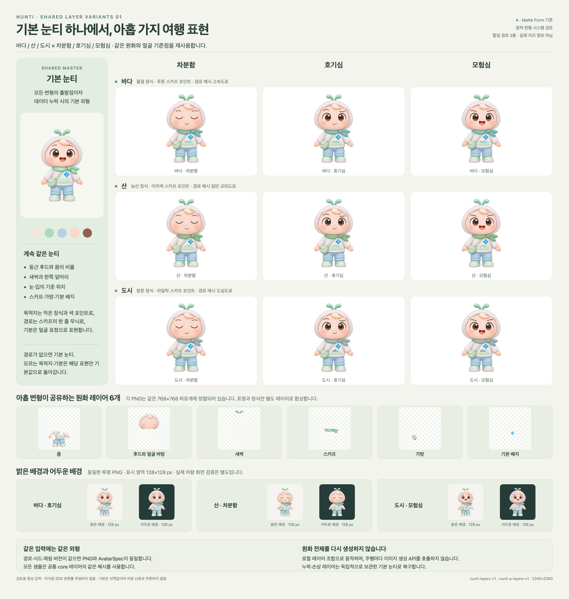
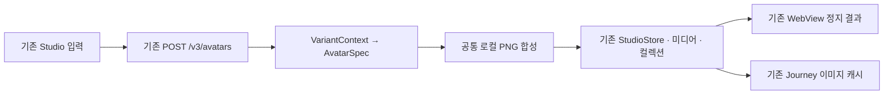

# 눈티 A 경로 변형 시스템 v1

2026-11-09. 사용자가 선택한 **A / Matte Form**을 기준으로, 기존 Avatar Studio에 `LOCAL_LAYERS` 생성 방식을 추가했다. 기본형과 바다·산·도시 × 차분함·호기심·모험심의 9개 변형을 실제 공통 PNG 레이어로 합성한다.

승인 기준은 [A 정면 원화](../identity-refine-v1/nunti-a-front-transparent-v1.png)와 [A 시트 v3](../identity-refine-v1/nunti-a-sheet-v3.png)다. 기존 원본과 다른 생성 방식은 그대로 보존했다. 이번 결과는 정지 이미지 시스템이다. 변신 애니메이션은 아직 연결하지 않았다.



## 결과 파일

| 결과 | 위치 |
| --- | --- |
| 기본형 + 9개 변형 비교 보드 | [PNG](comparison-board.png), [독립 HTML](comparison-board.html) |
| 10개 이미지·AvatarSpec·요청·렌더 기록 | [샘플 인덱스](samples/index.json), [기본형](samples/base/character.png), [바다·호기심 예시](samples/coast-curious/AvatarSpec.json) |
| 재사용 레이어와 출처·해시 | [에셋 manifest](../../../backend/nunti/avatar_studio/assets/nunti-a-layers-v1/manifest.json) |
| 입력 규칙과 기본형 처리 | [mapping.md](mapping.md) |
| 자동 검사와 실제 Pleos 화면 | [verification.md](verification.md), [실행 보고서](runtime/report.json) |
| JSON 계약 | [AvatarSpec.schema.json](AvatarSpec.schema.json) |

각 `samples/<이름>/` 폴더에는 `character.png`, `AvatarSpec.json`, `request.json`, `render-metadata.json`을 함께 저장했다. PNG는 768 × 768 RGBA다. 샘플 경로는 지리 좌표가 아닌 합성 화면 좌표이며, 분류와 기분도 `mock`으로 표시했다.

## 레이어 구성

| 영역 | 수 | 변경 규칙 |
| --- | ---: | --- |
| 몸, 머리, 새싹, 스카프, 가방, 브랜드 배지 | 6 | 모든 변형에서 같은 파일과 SHA256 재사용 |
| 표정 | 4 | 원래 기본 표정 + 차분함·호기심·모험심 중 하나 |
| 목적지 | 3 | 스카프 색 포인트와 포켓의 물결·능선·창문 중 하나 |
| 경로 | 12 | 도심·고속도로·교외·혼합 도로별 작은 스카프 선, 각 3가지 |
| 완성 기본형 | 2 | `base.png`와 별도 `fallback/base.png` |

총 27개 PNG다. 합성 순서는 기본 6개 → 표정 1개 → 목적지 최대 1개 → 경로 최대 1개다. 얼굴 앵커는 768px 캔버스에서 왼눈 `(316,274)`, 오른눈 `(463,274)`, 입 `(391,337)`로 고정했다. 브랜드 배지는 목적지 장식과 분리했다.

레이어는 원화의 **보이는 픽셀을 분리한 정지 합성용 레이어**다. 가려진 몸통이나 후두부까지 복원한 관절 리그가 아니다. 팔·머리를 크게 움직이면 빈 영역이 드러날 수 있으므로 그런 애니메이션에는 추가 원화가 필요하다.

원화의 RGB를 유지하고 알파 노이즈를 정리한 뒤 정렬했다. 얼굴 안쪽의 작은 마스크에만 한 번 생성한 피부 바탕을 사용했다. 그 밖의 실루엣에는 생성 결과를 사용하지 않았다. 기본 표정 레이어를 다시 올리면 패키지의 기본형과 픽셀 단위로 일치한다. [생성 프롬프트](source-prompts.json), [레이어 빌더](../../../scripts/build_nunti_layer_assets.py)에 과정을 기록했다.

## 기존 앱 연결



앱의 이미지 생성 방식에서 **기본 눈티 A · 모습 조합**을 선택하면 목적지 종류, 길의 종류, 직접 고른 기분을 지정할 수 있다. 기본 선택은 기존 `LOCAL_RENDER`로 유지했다. 새 서버 기능을 광고하지 않는 서버에서는 새 선택지를 숨긴다.

[models.py](../../../backend/nunti/avatar_studio/models.py)에 선택형 `variantContext`와 `LOCAL_LAYERS`를 추가했다. 기존 [API](../../../backend/nunti/avatar_studio/api.py)의 인증, 요청 재시도, 저장소, 미디어 URL, 컬렉션, 음성 계획을 재사용한다. `LOCAL_LAYERS`만 경로 없는 입력을 허용하며, 다른 방식의 경로 검증은 유지한다.

[variant_spec.py](../../../backend/nunti/avatar_studio/variant_spec.py)는 순수 매핑 함수와 Pydantic 타입을 제공한다. [layered_render.py](../../../backend/nunti/avatar_studio/layered_render.py)는 기존 렌더러의 `PNG bytes + design` 반환 형태를 따른다. `design.avatarSpec`과 별도의 JSON 미디어 파일에 같은 명세를 저장한다. 응답 최상위 `avatarSpec.path`와 `avatarSpec.sha256`으로 이 JSON을 조회·검증할 수 있다. 기존 서버 v1 및 Android의 다른 `AvatarSpec` 타입은 변경하지 않았다.

결과에는 `mediaOrigin=LOCAL_LAYERS`, `design.staticOnly=true`, `motion=none`을 기록한다. Studio의 탄생 효과·재생·대기 움직임을 건너뛰고, 네이티브 Journey도 이 표시를 읽어 캐릭터 장식 움직임을 끈다. 차량 UX 제한 판단은 기존 로직을 그대로 따른다.

## 재현

저장된 입력으로 다시 내보내는 데 이미지 모델이나 외부 API는 필요 없다. 저장소 루트에서 프로젝트의 Python 3.12 이상 환경을 사용한다. 이 작업에서 확인한 환경은 `.worktrees/server/backend/.venv/bin/python`이다.

```sh
.worktrees/server/backend/.venv/bin/python scripts/export_nunti_variants.py
```

이 명령은 실제 런타임 합성기를 사용해 샘플, JSON 스키마, 비교 HTML과 일관성 보고서를 생성한다. PNG 비교 보드는 이 HTML을 2240 × 2360으로 캡처한 파일이다. 저장된 PNG는 추가 이미지 생성 없이 그대로 제공한다.

레이어 원본을 재구축할 때만 다음 명령을 쓴다. 원화와 저장된 얼굴 바탕 이미지가 필요하며, 새 이미지 생성 호출은 하지 않는다.

```sh
.worktrees/server/backend/.venv/bin/python scripts/build_nunti_layer_assets.py
```

동일한 입력과 버전에서 같은 PNG와 AvatarSpec이 나오는 것을 반복·병렬·별도 프로세스와 실제 HTTP 경로에서 확인했다. 파일 바이트 재현 검증은 Python 3.12.14 / Pillow 12.3.0에서 수행했다. PNG 인코더 버전이 달라질 때의 바이트 동일성은 별도 검증이 필요하다.

## 현재 범위와 다음 단계

이번 생성에는 로컬 Studio 서버가 필요하다. 렌더러 자체는 인터넷 없이 동작하고, 이미 받은 PNG는 기존 Journey 캐시로 재사용한다. 신규 합성기를 Android 안으로 이식하거나 기본 레이어를 APK에 내장한 것은 아니다. 서비스 연결이 끊긴 상태의 첫 생성까지 완전한 기기 내 생성으로 보장하지 않는다.

비교 보드의 128px에서는 실루엣과 새싹, 큰 눈이 우선 읽히고 작은 스카프 선은 약하게 보인다. 목적지 구분은 색만으로 전달하지 않도록 포켓 무늬와 한국어 접근성 라벨을 함께 저장한다. 실제 Pleos 결과 화면의 캐릭터 크기에서는 얼굴과 포켓 장식이 구분된다. 미세한 경로 선을 주행 중 읽어야 하는 정보로 사용하지 않는다.

다음 단계는 이 레이어를 이용해 **주차 상태에서 스카프·포켓 장식·표정이 순서대로 바뀌는 변신**을 붙이는 것이다. 기존 기본 눈티를 계속 보이게 유지하고, 제한 진입·건너뛰기·동작 줄이기는 곧바로 허용된 정지 프레임으로 전환하도록 설계한다. 그 단계에서 실제 차량 제한 전환, Figma 대조, 주야간 화면과 성능을 검증해야 한다.
