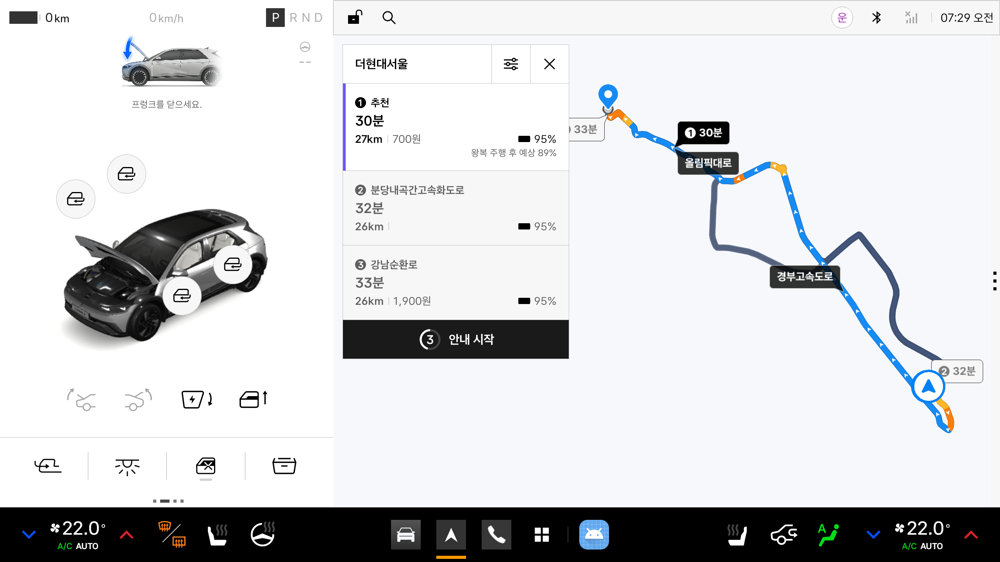
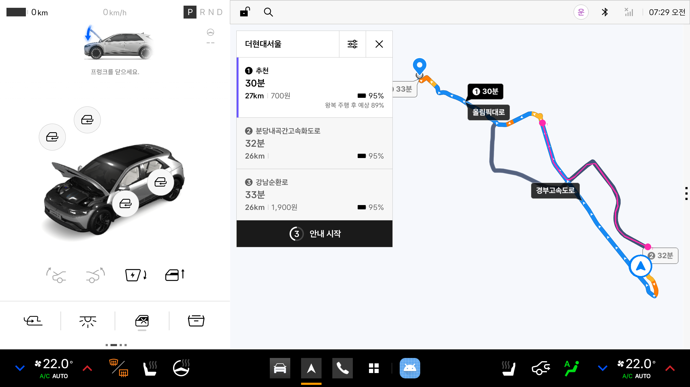

# Pleos 내비 실제 연동·경로 시험 검토

후속 구현은 [사진 없는 내비 API 연결 결과](../../design/navigation-integration/RESULT.ko.md)와 [시험 안내](../../design/navigation-integration/TESTING.ko.md)를 따른다. 아래는 구현 전 조사 기록이다. 이후 NaviHelper 콜백·별도 OSRM 도로 좌표·Android 생성과 복원을 연결했다. 사진 추출은 새 API 흐름에서 사용하지 않는다. 현대 원경로와의 일치, SDK의 GPS 이동 수신·재탐색 완료는 미검증으로 남았다.

2026-11-04, Asia/Seoul. 전체 목표는 운전습관 개선을 돕는 눈티이고 이번 담당 범위는 목적지·내비 경로 기반 아바타 생성이다. 공식 문서, 배포 SDK의 실제 클래스·소스, 현재 에뮬레이터와 눈티 코드를 대조했다.

## 결론

**에뮬레이터 내비를 활용할 수 있다. 다만 목적지·내비 상태 연동과 전체 도로 경로 형상 획득은 나누어 구현해야 한다.**

공식 NaviHelper로 목적지·현재 위치·경로 상태·탐색 완료 이벤트를 받을 수 있다. 실제 SDK의 `TripSummary.routePoints`는 경유지·목적지 요약점으로 정의돼 있다. 이를 촘촘한 도로 polyline이라고 보고 아바타에 연결하면 경로 모양을 잘못 전달한다. 확인한 공개 함수·데이터 타입에서는 전체 도로 polyline 반환 방법을 찾지 못했다. 모든 내부 기능이나 향후 제휴 API까지 없다는 뜻은 아니다.

개발 검증의 우선안은 **NaviHelper 메타데이터 + 선택 경로의 전체 보기 화면 + 출발·도착·선 확인**이다. 현재 눈티의 사진 추출기는 실제 다중 경로 화면에서 부분 경로를 오선택했으므로 그대로 자동 생성에 연결하면 안 된다.

## 에뮬레이터에서 실제 확인한 것

| 항목 | 직접 확인 |
|---|---|
| 장치 | Pleos Connect 2.1.0 ARM/API34, 사용자10 |
| 내비 앱 | `ai.umos.maps.android.navigation.app`, 3.3.2-rc5-hotfix.3 |
| SDK 서비스 | `ai.pleos.playground.service.navi`, 3.0.4/code55 |
| 권한 | NAVI_ROUTE·NAVI_ROUTE_SEARCH·NAVI_CUSTOM_MAP 등이 normal로 선언돼 있음 |
| 실제 탐색 | 공개 장소 더현대서울 검색·선택, 추천27km/30분과 대안2개 표시 |
| 길 안내 UI | 안내 화면과 안내 종료 버튼 확인. 시험 안내를 종료하고 눈티로 복귀 |
| 지도 배경 | 타일은 비어 있었지만 경로 선과 목적지 검색·계산은 동작. 타일 문제의 원인은 확정하지 않음 |

이것은 내비 앱 UI 시험이다. Nunti가 SDK 콜백을 실제로 받았거나 GPS 재생을 시험했다는 뜻은 아니다. 차량 기어·속도는 바꾸지 않았다. [장치 관측](device-inspection.json), [UI XML](route-preview-ui.xml), [구조화 결과](findings.json)을 보존했다.

## 공식 SDK에서 확인한 계약

공식 Maven의 `ai.pleos.playground:NaviHelper:3.0.5` AAR/POM과 실제 의존성 `navi-data:3.0.4` AAR·소스 JAR를 내려받아 공개 클래스와 KDoc를 읽었다. 파일 합계는 395,522bytes다. [공식 SDK 설치](https://document.pleos.ai/docs/pleos-only/connect-sdk-pleos/NaviHelper/importing-sdk), [파일·SHA 명세](sdk-artifacts.json)

| 입력·기능 | 확인한 의미 |
|---|---|
| `getDestinationInfo()` | 목적지 이름·주소·위경도·거리·시간·통행료 |
| `getCurrentLocationInfo()` | 현재 위치·방향·주소·routeId·currentRouteIndex |
| `getRouteStateInfo()` | 안내·탐색 상태·옵션·교통 상태. 전체 선 좌표가 아님 |
| `requestTrip()` → `TripInfo` | 거리·ETA·에너지·`TripSummary` |
| `TripSummary.routePoints` | 경유지·목적지 정보. pointType은 ORIGIN/WAYPOINT/DESTINATION, ratioOnRoute는0~100 |
| `getTBTInfo()` | 회전 종류·다음 회전까지 거리·설명. 전체 도로 형상이 아님 |
| `onRoutingCompleted()/onReRouteEnded()` | 탐색·재탐색 완료를 감지할 이벤트 |
| `NavigationScreenRequest.OverviewRoute` | 전체 경로 화면 표시 요청. PNG나 polyline 반환이 아님 |
| `NaviMode.SIMULATION_GUIDING` | 모의 주행 상태 enum. 확인한 공개 NaviHelper 함수에는 모의 주행 시작 함수가 없음 |

위 내용은 [공식 소개](https://document.pleos.ai/docs/pleos-only/connect-sdk-pleos/NaviHelper/intro), [공식 데이터 소스 JAR](https://nexus-playground.pleos.ai/repository/maven-releases/ai/pleos/playground/navi-data/3.0.4/navi-data-3.0.4-sources.jar)와 실제 배포 클래스를 대조한 것이다. 로컬 선택 소스와 javap는 `.local/navigation-review/official/`에 보존했다. latitude·longitude는 필드명을 기준으로 매핑하며 GeoJSON의 longitude·latitude 순서와 구분한다.

조회·Trip 요청에는 `NAVI_ROUTE`, 목적지·경로 변경에는 `NAVI_ROUTE_SEARCH`, 화면 요청에는 `NAVI_CUSTOM_MAP`이 필요하다. 설치된 서비스의 선언은 normal이다. 실제 Nunti 앱이 이를 선언해 콜백을 수신하는 검증은 아직 하지 않았다. SDK AAR의 최소 Android는23, 최소 서비스는2.0.1/code11로 선언돼 있어 현 장치는 선언상 최소 조건을 충족한다. 이것을 실제 연결 성공과 동일하게 취급하지 않는다. [권한 규격](https://document.pleos.ai/docs/pleos-only/connect-sdk-pleos/NaviHelper/declaring-permissions)

NaviHelper는 공식 안내상 SDK 사용 신청 없이 사용 가능하다. 별도 내비 REST API 키는 안내되지 않으며 Client ID/Secret 설명은 서버 연결 음성 SDK용이다. Emulator2.1.0부터 CRN 입력도 불필요하다. [프로젝트·SDK 안내](https://document.pleos.ai/docs/pleos-only/create-my-project)

## 실제 SDK 콜백과 구형 완료 이벤트

눈티에 연결한 실제 SDK 결과 `.local/navigation-integration/native-route-result.json`에는 `onRouteStarted` 다음 약12ms 뒤 `onRouteEnded`가 기록됐다. 그 뒤 조회 결과는 `naviMode=ROUTE_GUIDING`, 비어 있지 않은 `routeId`, 더현대서울 목적지, 남은 거리27km, 회전 안내를 반환했다. 이때 `isRouting`은 `false`였다.

공식 NaviHelper3.0.5 배포 클래스의 `onRouteEnded`에는 `@Deprecated`가 선언돼 있다. 대체 함수는 `onRoutingCompleted()`다. 이 구형 콜백은 경로 탐색 완료를 뜻하므로 안내 종료로 처리하면 목적지와 회전 안내를 잘못 지운다. 어댑터는 원본 이벤트 이름을 보존하고 lifecycle을 `READY`로 기록한다. `onRouteStarted`는 `ROUTING_STARTED`로 기록한다. 목적지·Trip·TBT를 지우는 명시적인 콜백은 `onRouteCancelled`다. [공식 이벤트 설명](https://document.pleos.ai/docs/pleos-only/connect-sdk-pleos/NaviHelper/event-listeners), [배포 클래스의 annotation 원문](legacy-callback-contract.txt)

`RouteStateInfo.isRouting`의 공개 KDoc는 경로 활성 여부라고 설명하지만, 위 실제 응답과 일치하지 않는다. 이 차이의 원인은 아직 확정하지 않았다. 원본 `false`를 보존하며, 안내 여부를 시험할 때는 `naviMode`, `routeId`, 목적지, 남은 거리와 회전 안내를 함께 확인한다. `isRouting=false` 하나로 안내 종료나 경로 부재를 판정하지 않는다. lifecycle은 마지막 탐색 이벤트이며 현재 안내 상태 전체를 대신하지 않는다.

## 실제 경로 사진을 넣었을 때 발견한 문제

같은 실제 경로 미리보기 PNG를 현행 `extract_route()`에 자동 색상·blue 지정으로 각각 넣었다. 원본 화면에서는15점을 반환했지만, 겹쳐 확인하니 교통색 구간 뒤에서 시작해 대안 경로 일부를 따라갔다. 출발·목적지 마커까지 온전하게 연결하지 못했다. 지도 영역만 자른 사진은 두 방식 모두 `OTHER_ROUTE_GEOMETRY_AMBIGUOUS`로 거절됐다.

[실제 추출 결과·원본 SHA](screenshot-extraction.json)를 보존했다. 현재 추출기의 통과 수치·confidence는 전체 선택 경로의 정확도를 뜻하지 않는다. 또한 끝점은 화면 x/y 순으로 정렬하므로 실제 진행 방향을 이해하지 않는다. 이전 합성 사진·보관 복원 테스트의 통과와 이 실제 내비 사진의 정확도를 구분한다.

다음 보강은 단일 선택 경로 전체 보기, 교통색 변화·흰 화살표·가림 처리, 시작·끝 마커 또는 사용자 지정, 경로 뒤집기, 경로 일부만 추출됐을 때 생성 차단이다. 실제 원본과 선을 확인하기 전에는 아바타를 새로 생성하지 않는다.

## 추천 구현·시험 순서

1. **SDK 읽기 연결부터 확인.** Android adapter에서 initialize → listener → 목적지·상태·현재위치 조회를 수행한다. 원본 snapshot·routeId·목적지·옵션·조회 시각·단위와 콜백을 보존한다. 현재 순수 JVM navigation 모듈에 Android 서비스 의존성을 넣지 않는다.
2. **선택 경로의 전체 형상을 확인.** `OverviewRoute(RouteOverviewShowInfo(...))`로 전체 보기 화면을 요청한다. 개발 중에는 에뮬레이터 정지 PNG를 사용한다. 한 경로를 표시하고 시작·끝·진행 방향을 확인할 도구를 보강한 뒤 현재 사진 입력 또는 확인된 좌표 JSON으로 연결한다. 화면 요청 권한이 자동 캡처 권한을 주는 것은 아니며 제품의 자동 캡처는 별도 구현 사항이다.
3. **같은 경로 snapshot을 반복 시험.** 직선·큰 굴곡·루프·재탐색 사례의 원본 화면과 확인된 좌표를 묶는다. 좌표는 등비율로0~1에 맞추고 방향·출처를 보존한다. 실제 SDK 입력에는 별도 `NAVI_HELPER` 출처와 snapshot 참조를 설계하며 임의로 TEST_ROUTE라고 보내지 않는다.
4. **필요하면 GPS 재생 추가.** Android Emulator Extended controls의 Location → Routes 또는 GPX/KML을 사용한다. Pleos 내비가 이 위치를 소비하는지는 SDK 현재위치 콜백과 대조해야 한다. 계획 경로, 재생 GPS 위치, Virtual Console의 속도·기어는 서로 다른 데이터다. [Android 공식 재생 안내](https://developer.android.com/studio/run/emulator-extended-controls), [Pleos Console](https://document.pleos.ai/en/docs/connect/guide/getting-started/application-development/use-vehicle-emulator)

재탐색은 같은 여정의 route revision으로 처리하고 캐릭터를 매번 새로 만들지 않는다. 내비 화면에서 돌아와 P·정차 상태에서 불러오고 확인·생성하는 흐름부터 구현하면 현재 차량 gate를 유지할 수 있다. 실제 전체 좌표를 자동으로 받아야 한다면 현대/내비 공급자에게 별도 기하 API 제공 여부를 확인해야 한다. 다른 경로 엔진으로 재계산한 선을 현대 내비의 같은 선택 경로라고 보고하지 않는다.

## 현재 눈티와 남은 일

현재 앱에는 NaviHelper 의존성·권한·콜백 adapter·경로 전달 bridge가 없다. 서버는0~1 좌표2~512점과 TEST_ROUTE/NAVIGATION_SCREENSHOT/ROUTE_FILE만 받으며 GeoJSON·GPX를 직접 받지 않는다. 사진 입력·실루엣 생성·보관 기능은 구현돼 있지만 실제 선택 경로의 완전한 추출은 위 사례에서 미검증이다.

이번에는 내비 앱·실제 탐색 UI, SDK 정적 계약, 사진 추출의 한계를 확인했다. 앱 APK 설치·Nunti production 코드 수정·SDK live callback·GPS 이동·새 아바타 생성·유료 API·영상·음성 녹음은 하지 않았다.

재현 관측 도구는 [inspect_pleos_navigation.py](../../../scripts/inspect_pleos_navigation.py)다. 기본은 설치 버전·권한만 읽으며 `--snapshot --log-counts`를 선택하면 내비 포커스 때 정지 PNG/XML과 제한된 오류 횟수를 저장한다. 원시 로그나 URL·키는 저장하지 않는다. 로그 오류가0건이어도 전체 연결 정상으로 판정하지 않는다. 이 검토 도구가 내비 SDK adapter를 구현한 것은 아니다.
